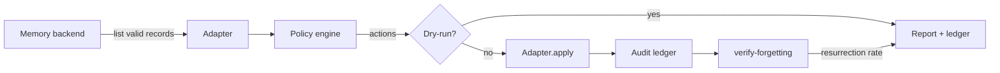

# memgov

**Backend-agnostic memory governance for AI agents.**

[](https://github.com/dxqlovestudy/memgov/actions/workflows/ci.yml)
[](https://www.python.org/)
[](LICENSE)
[](#status)

Most memory systems compete on **recall**: remember more, retrieve better. `memgov`
competes on the missing half — **governance**: what should expire, what replaced what,
what is a duplicate, what must stay forgotten, and who can prove it later.

It sits beside an existing memory backend (Hindsight, Mem0, Graphiti, a JSON file, your
own service). It does not store memories and does not rank recall results.

```
read snapshot → evaluate policies → dry-run report → apply → audit ledger → verify forgetting
```

## Why

Long-running agents do not only forget; their memory **degrades silently**:

- stale facts keep matching queries long after they stopped being true;
- the same rule is stored five times with slightly different wording;
- temporary task state is kept forever and competes with durable preferences;
- a deleted or invalidated fact comes back through a derived copy;
- nobody can explain why a memory was removed three weeks ago.

Recall benchmarks do not measure these. `memgov` makes them explicit, policy-driven and
reversible.

## What it does

| Capability | Policy | Action |
|---|---|---|
| Age-based expiry | `ttl` | invalidate / archive |
| Explicit replacement | `supersede` | invalidate the replaced record |
| Duplicate collapse (exact + near) | `dedup` | invalidate the lower-value copy |
| Importance decay | `importance` | archive below a score |
| Per-scope capacity | `scope_limit` | evict lowest score |
| Post-action assurance | `verify-forgetting` | measure resurrection rate |

Every action is written to an audit ledger with the record's **before** snapshot and a
reason. Invalidation is reversible: `memgov rollback --apply` restores the record.

## Architecture



- **Adapters** normalize a backend into `MemoryRecord` objects and apply mutations.
- **Policies** are pure functions over a snapshot; no policy calls the backend directly.
- **Engine** resolves conflicts (first policy wins) and records warnings.
- **Ledger** stores one JSON file per run plus an append-only `ledger.jsonl`.
- **Verification** re-queries recall after invalidation to measure whether the fact is
  really gone (including derived copies).

## Quickstart

```bash
git clone https://github.com/dxqlovestudy/memgov.git
cd memgov
python3 -m venv .venv && source .venv/bin/activate
pip install -e ".[dev]"

# offline demo: TTL + supersede + dedup over six sample records
memgov demo

# your own JSON snapshot
memgov scan --adapter jsonfile --jsonfile examples/sample_memories.json \
  --policy examples/policies/default.yaml

# Hindsight, read-only dry-run
memgov scan --adapter hindsight \
  --base-url http://127.0.0.1:8888 --bank dxq \
  --policy examples/policies/default.yaml
```

`scan` is a **dry-run** unless you pass `--apply`. Hindsight additionally requires
`MEMGOV_ALLOW_WRITE=1`, so two independent switches must agree before anything mutates.

## AI governance (full-auto, opt-in)

The core engine stays deterministic. A separate `ai-govern` command adds an
OpenAI-compatible judge for the cases rules cannot see: paraphrased duplicates,
implicit supersession, and contradictory facts.

```bash
export MEMGOV_AI_BASE_URL="https://your-gateway/v1"
export MEMGOV_AI_MODEL="deepseek-flash"
export MEMGOV_AI_API_KEY="..."

# candidates only: no model calls, no writes
memgov ai-govern --adapter hindsight --base-url http://127.0.0.1:8888 --bank dxq \
  --candidates-only --max-pairs 20

# full-auto: model decides, apply, verify, auto-rollback on failure
memgov ai-govern --adapter hindsight --base-url http://127.0.0.1:8888 --bank dxq \
  --max-pairs 50 --max-invalidations 10 --confidence 0.85 --apply
```

The model is a proposer whose output is validated before it can become an action:

- strict JSON schema; ids must match the pair;
- every `evidence.quote` must be an exact substring of the referenced record;
- confidence threshold (default 0.85);
- keep-newer unless the older record has `authority:official`;
- only `invalidate` (reversible), never delete;
- per-run caps (`--max-invalidations`, `--max-pairs`);
- post-apply forgetting verification; auto-rollback if the failure rate is too high.

Prompt and gates: [docs/ai-governance.md](docs/ai-governance.md).
Measured: one real supersede pair → 0.97–0.98 confidence, 839–849 tokens; three
related-but-not-conflicting pairs → all `keep_both`, 3,615 tokens.

## Policies

```yaml
version: 1
policies:
  - name: ttl
    enabled: true
    rules:
      - tag: ephemeral
        max_age_days: 7
      - tag_prefix: "task:"
        max_age_days: 14
      - kind: experience
        max_age_days: 90

  - name: supersede      # only explicit metadata/tags, never similarity
    enabled: true

  - name: dedup
    enabled: true
    similarity: 0.95    # Jaccard over character bigrams
    signature_size: 16  # blocking keys per record
    max_candidates: 300

  - name: importance     # off by default: needs a backend importance signal
    enabled: false
    half_life_days: 90
    archive_below: 0.15

  - name: scope_limit
    enabled: false
    max_per_scope: 500
    tag_prefix: "scope:"
```

See [docs/policies.md](docs/policies.md) for every option and the trade-offs.

## Adapters

| Adapter | List | Invalidate | Delete | Importance | Recall |
|---|---|---|---|---|---|
| `memory` | ✓ | ✓ | ✓ | ✓ | ✓ |
| `jsonfile` | ✓ | ✓ | ✓ | ✓ | ✓ |
| `hindsight` | ✓ (world/experience only) | ✓ | opt-in | — | ✓ |

Hindsight notes:

- derived `observation` records are hidden: the API rejects curating them;
- there is no TTL, supersede chain, importance or usage signal in Hindsight 1.2.x, so
  those policies either use tags/metadata you write yourself or report a warning;
- `delete` is disabled unless `allow_delete=True` (destructive and not reversible).

Adding a backend means implementing four methods: `list_memories`, `apply`, `restore`,
`recall`. See [docs/adapters.md](docs/adapters.md).

## CLI

```text
memgov scan              evaluate policies (dry-run by default; --apply to mutate)
memgov ai-govern         full-auto AI judgement: candidates -> model -> apply -> verify
memgov report <run>      render a stored run
memgov rollback <run>    restore memories invalidated by a run (--apply)
memgov verify-forgetting <run>  measure whether invalidated facts still come back
memgov adapters          show adapter capabilities
memgov demo              offline end-to-end demo
```

## Metrics

`memgov` reports governance actions, not just memory size:

| Metric | Meaning |
|---|---|
| `records_scanned` | live records the policies saw |
| actions by policy | ttl / supersede / dedup / importance / scope_limit |
| `applied` / `errors` | mutations that succeeded or failed |
| **forgetting failure rate (F)** | share of invalidated records still returned by recall |
| `warnings` | unsupported capabilities, claimed-record conflicts |

The forgetting metric follows the *active forgetting* dimension of
[GateMem](https://github.com/rzhub/GateMem); the lifecycle vocabulary
(write → expire → revoke → purge) is aligned with
[MGP](https://github.com/HKUDS/MGP). See [docs/metrics.md](docs/metrics.md).

## Design principles

1. **Dry-run by default.** Every mutation needs an explicit flag.
2. **Explicit evidence only.** Supersede never guesses from similarity; no match means
   no action, not a best guess.
3. **Reversible by default.** Invalidate, don't delete; keep a before snapshot and a
   reason for every action.
4. **Backend-agnostic.** Policies operate on a neutral record; capabilities decide what
   is possible.
5. **Bounded work.** Blocking + candidate caps keep scans near-linear on real banks.
6. **No silent failures.** Unsupported policies warn instead of pretending to run.

## Status

`v0.2.0` — alpha. The engine, adapters, ledger, CLI and full-auto AI judge are
functional and covered by tests; the policy set is intentionally small. Not
production-hardened.

Roadmap:

- [ ] PostgreSQL / S3 ledger backend
- [ ] Mem0 and Graphiti adapters
- [ ] scheduled service mode with per-bank policies
- [ ] OpenTelemetry metrics
- [x] AI-assisted conflict/supersede/duplicate judgement (`ai-govern`, full-auto)
- [ ] human approval queue (optional mode)
- [ ] richer conflict evidence (quote spans, authority labels)

## 中文简介

`memgov` 是一个**与存储后端无关的记忆治理引擎**：不负责存记忆、也不负责召回排序，
只负责“哪些该过期、谁取代了谁、哪些是重复、失效后是否真的不再被召回”，并把每个
动作写进可回滚的审计台账。默认 dry-run，`--apply` 才写入；Hindsight 还需要额外的
`MEMGOV_ALLOW_WRITE=1`。

## Contributing

See [CONTRIBUTING.md](CONTRIBUTING.md). Please open an issue before adding a new policy
or adapter so the contract stays small.

## License

MIT — see [LICENSE](LICENSE).
