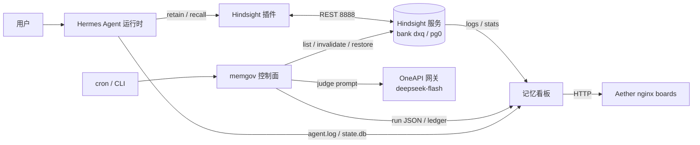
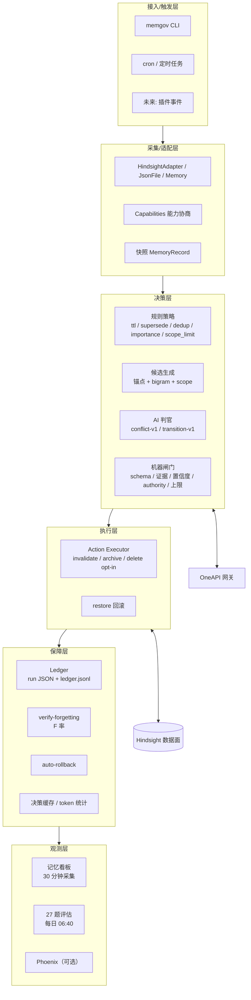
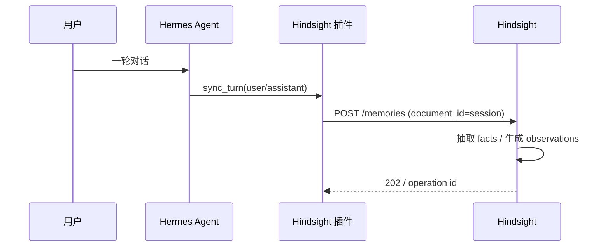
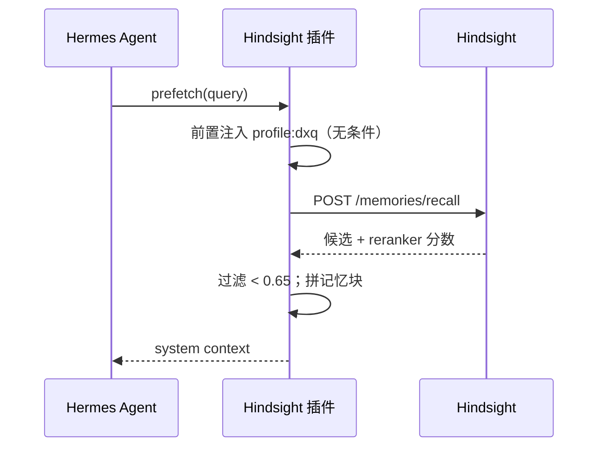
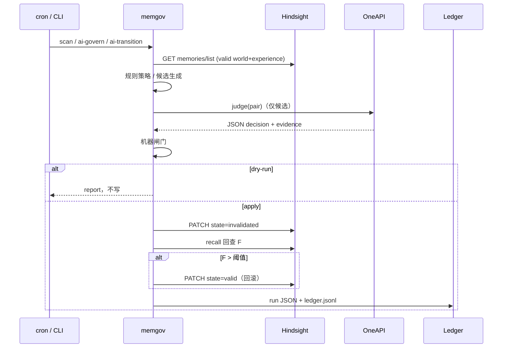
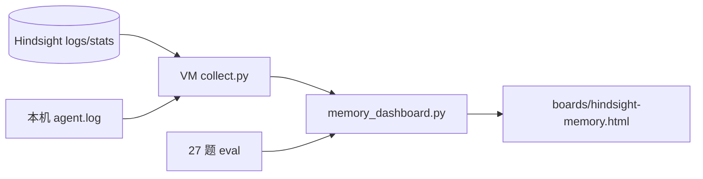

# 记忆治理引擎系统架构

## 0. 先回答「架构在哪里」

- 仓库 `README.md` 只有一张**引擎内部**流程图（Adapter → Policy → Ledger），不是系统架构。
- `docs/design.md` 讲的是设计原则与生命周期，也没有覆盖 Hermes、Hindsight、AI 网关、看板、调度器的部署关系。
- 本文是**第一份系统级架构文档**：覆盖对话链路、治理控制面、数据面、AI 网关、观测面、部署拓扑与边界。

## 1. 结论摘要

系统分三层，**治理控制面与对话链路解耦**：

| 层 | 角色 | 一句话 |
|---|---|---|
| 数据面 | Hindsight | 唯一真源：存文档、事实、observation，提供 recall |
| 控制面 | memgov | 只做治理：读快照、判去留、发失效/恢复动作、记账、回查 |
| 观测面 | dashboard + 27 题评估 + Phoenix（可选） | 只看结果：质量、延迟、库健康、遗忘失败率 |

三条硬边界：

1. **memgov 不在每轮对话路径上**：对话写入/召回由 Hermes 插件直接打 Hindsight；memgov 通过 cron/CLI 批量治理。
2. **memgov 不存记忆、不做召回排序**：数据面唯一真源是 Hindsight。
3. **所有写动作可逆**：只 `invalidate`，`restore` 即回滚；删除需显式开启。

## 2. 系统上下文



外部系统：

| 系统 | 位置 | 作用 |
|---|---|---|
| Hermes Desktop / Gateway | 本机 macOS | 对话运行时、插件宿主、日志与 state.db |
| Hindsight 服务 | Aether VM `172.20.12.116:8888` | 记忆数据面（docker + pg0） |
| OneAPI 网关 | `oneapi.xgd.com/v1` | LLM 判官（deepseek-flash） |
| Aether nginx | `172.20.12.116:80` | 看板/设计文档发布 |
| Phoenix（可选） | `172.20.12.116:6006` | Hermes OTel 轨迹观测，不参与治理 |

## 3. 分层架构



## 4. 组件清单

| 层 | 组件 | 代码/位置 | 职责 | 状态 |
|---|---|---|---|---|
| 接入 | CLI | `src/memgov/cli.py` | `scan / ai-govern / ai-transition / report / rollback / verify-forgetting` | v0.2 已实现（`ai-transition` 设计中） |
| 接入 | cron | 本机 Hermes cron | 30 分钟看板采集、每日 06:40 评估 | 已运行 |
| 接入 | 插件事件（未来） | Hindsight 插件 | 写入时发 `state_transition` 事件 | 未实现 |
| 采集 | HindsightAdapter | `src/memgov/adapters/hindsight.py` | 列出 world/experience、失效、恢复、recall | 已实现 |
| 采集 | 其他 Adapter | `jsonfile.py` / `memory.py` | 离线评估/测试 | 已实现 |
| 采集 | Capabilities | `src/memgov/policies.py` | 后端能力协商，缺能力跳过并告警 | 已实现 |
| 决策 | 规则策略 | `src/memgov/policies.py` | ttl / supersede / dedup / importance / scope_limit | 已实现 |
| 决策 | 候选生成 | `src/memgov/candidates.py` | 0.75×bigram + 0.25×锚点；scope 候选（v0.3） | v0.2 已实现；v0.3 dry-run 已实现 |
| 决策 | AI 判官 | `src/memgov/ai.py` + `prompts.py` | `conflict-v1` 两两判；`transition-v1` 状态迁移（设计中） | conflict-v1 已实测；transition-v1 设计 |
| 决策 | 机器闸门 | `ai.py` / `ai_governor.py` | schema、证据子串、置信度、keep-newer、上限、注入 | 已实现（transition 闸门设计） |
| 执行 | Executor | `engine.py` / `adapters/*.py` | 只失效；archive 映射 invalidate；delete opt-in | 已实现 |
| 执行 | restore | `adapters/*.py` | `PATCH state=valid` | 已实现 |
| 保障 | Ledger | `src/memgov/ledger.py` | run JSON、`ledger.jsonl`、before、reason | 已实现 |
| 保障 | verify-forgetting | `src/memgov/ledger.py` | 回查 F 率；id 或近似原文命中即失败 | 已实现 |
| 保障 | auto-rollback | `src/memgov/ai_governor.py` | F > 阈值恢复本轮全部动作 | 已实现 |
| 观测 | 记忆看板 | 工作单元 `scripts/memory_dashboard.py` + VM `/opt/memory-dashboard/collect.py` | 质量/延迟/库健康/新鲜度 | 已运行 |
| 观测 | 27 题评估 | 工作单元 `scripts/eval_hindsight.py` | 命中/MRR/噪声/陈旧/延迟 | 已运行 |
| 观测 | Phoenix | Hermes OTel 插件 | 轨迹观测，不参与治理 | 已有，可选 |

## 5. 数据流

### 5.1 对话写入（实时）



### 5.2 对话召回（实时）



### 5.3 治理运行（批处理）



### 5.4 观测（定时）



## 6. 接口与契约

### 6.1 Adapter 契约

| 方法 | 输入 | 输出 | 说明 |
|---|---|---|---|
| `list_memories(limit)` | 上限 | `MemoryRecord[]` | 只返回可策展记录；Hindsight 只 world/experience |
| `apply(action)` | `Action` | bool | 只失效/归档/删除（opt-in） |
| `restore(memory_id)` | id | bool | `PATCH state=valid` |
| `recall(query, limit)` | 文本 | 结果 | 用于遗忘回查 |

### 6.2 Hindsight 接口（实际使用）

| 用途 | 接口 |
|---|---|
| 列表 | `GET /v1/default/banks/dxq/memories/list?state=valid&limit&offset` |
| 失效 | `PATCH /v1/default/banks/dxq/memories/{id}` `{state:"invalidated", reason}` |
| 恢复 | `PATCH .../{id}` `{state:"valid"}` |
| 召回 | `POST /v1/default/banks/dxq/memories/recall` |
| 库结构 | `GET /v1/default/banks/dxq/stats` |
| 文档 | `GET /v1/default/banks/dxq/documents/{id}` |

### 6.3 Action 契约

```json
{
  "action": "invalidate",
  "memory_id": "<id>",
  "policy": "ttl | supersede | dedup | ai | state_transition",
  "reason": "<可核对原因>",
  "replacement_id": "<id or null>",
  "before": {"id": "...", "text": "...", "state": "valid"},
  "reversible": true,
  "applied": false
}
```

### 6.4 写开关

| 层 | 开关 | 默认 |
|---|---|---|
| CLI | `--apply` | 关（dry-run） |
| 进程 | `MEMGOV_ALLOW_WRITE=1` | 关 |
| 适配器 | `allow_write` / `allow_delete` | 关 |

三者同时成立才写 Hindsight；单元测试用 `allow_write=True` 绕过 CLI 层。

## 7. 部署拓扑

| 位置 | 组件 | 端口/路径 | 备注 |
|---|---|---|---|
| 本机 macOS | Hermes Desktop / Gateway | — | 对话、插件、state.db、agent.log |
| 本机 macOS | memgov CLI / cron | `~/agentdt/开源项目/memgov` | 治理运行、看板采集、评估 |
| Aether VM | Hindsight 服务 | `172.20.12.116:8888` | docker `hindsight`，pg0 数据卷 |
| Aether VM | nginx boards | `172.20.12.116:80` | `hindsight-memory.html`、设计文档 |
| Aether VM | Phoenix（可选） | `172.20.12.116:6006` | OTel 轨迹 |
| 外部 | OneAPI | `oneapi.xgd.com/v1` | deepseek-flash / embedding / rerank |

网络与安全：

- Hindsight 8888/9999 **无鉴权**，只允许内网/tailnet，不映射公网。
- OneAPI key 只存在进程环境/VM env，不进仓库、不进文档。
- 看板只读 Hindsight logs/stats 与本地日志，不写记忆。

## 8. 失败模式与保障

| 失败 | 检测 | 处理 |
|---|---|---|
| 召回慢/断连 | 24h p90、取消数、`recall failed` | 看板标红；不改召回链路 |
| retain 未可见 | prefetch timeout 计数 | 看板显示；治理不依赖最新一轮 |
| 治理判错 | 证据子串、置信度、keep-newer、authority | 拒绝动作 |
| 失效不生效 | verify-forgetting F 率 | 超阈值自动回滚 |
| 并发写 | apply 前重读 state/updated_at | 跳过并告警 |
| 候选爆炸 | scope 索引 + 四重上限 | 停手并报告 |
| 台账不可查 | run JSON 完整性 | 每个动作 before/reason/applied |

## 9. 现状与缺口

### 已实现（v0.2）

- Hindsight/JSON/Memory 三适配器；
- 规则策略 5 类；
- AI 两两判官 `conflict-v1` + 证据/置信度/新旧/上限/自动回滚；
- 台账、回查、缓存、token 统计；
- 30 分钟看板 + 每日 27 题评估；
- 56 条测试、CI 三档。

### 已实现 dry-run（v0.3）

- 状态迁移判官 `transition-v1`；
- scope 实体索引与别名表；
- `ai-transition` CLI；
- 历史事实 `status:historical` 处理。

### 缺失/未做

| 缺口 | 影响 | 建议 |
|---|---|---|
| 事件驱动触发 | 迁移事实要等下一次扫描 | 第二阶段插件发事件 |
| 服务化/队列 | 目前是 CLI + cron，无并发 worker | 需要常驻时再上 |
| 台账数据库 | JSONL 不适合多机/高并发 | Postgres/S3 |
| 鉴权 | Hindsight 8888 无认证 | 只在内网，后续加反代 |
| 多 bank | 目前固定 `dxq` | 多租户时抽象 bank registry |
| SLO/告警 | 看板只展示，不主动告警 | 接 cron 告警/企业微信 |

## 10. 演进路线

| 阶段 | 内容 | 退出条件 |
|---|---|---|
| P1 | 架构文档 + 状态迁移 dry-run | 文档确认、候选可审 |
| P2 | `transition-v1` 判官 dry-run | 30 对标注精确率 ≥90% |
| P3 | 小批量 apply（max_invalidations=3） | 一周零回滚、抽检零误杀 |
| P4 | 服务化：事件触发 + Postgres 台账 + 告警 | 多会话/多 bank 稳定 |

## 11. 待拍板

| # | 问题 | 选项 | 推荐 |
|---|---|---|---|
| 1 | 治理跑在哪 | 本机 cron（现状） / Aether VM systemd | **VM systemd**（常驻、离数据面近） |
| 2 | 触发方式 | cron 批量 / 插件事件 | **先 cron，后事件** |
| 3 | 台账存储 | 文件 JSONL / Postgres | **先文件，服务化时换 PG** |
| 4 | 观测 | 看板 / Phoenix / 两者 | **看板为主，Phoenix 可选** |
| 5 | 多 bank | 单 bank dxq / 多租户 | **先单 bank** |

## 12. 与状态迁移设计的关系

- 本文是**系统级架构**：说明组件、数据流、部署、边界。
- `docs/state-transition-design.md` 是**功能级设计**：说明 `transition-v1` 的判据、候选、提示词、验收。
- 两者关系：状态迁移是控制面里的一个新增决策器 + 一个新增 CLI 命令，不改变数据面与对话链路。
